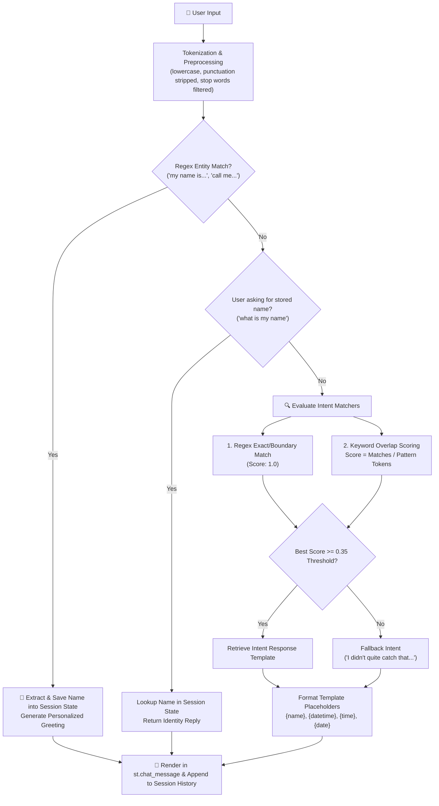

# 🤖 Rule-Based Chatbot with Streamlit

[](https://www.python.org/)
[](https://streamlit.io/)
[](https://pytest.org/)
[](LICENSE)
[]()

> A modular, beginner-friendly **Rule-Based Chatbot** built in Python with an interactive **Streamlit chat interface**. Powered by **regular expression pattern matching**, **keyword-overlap scoring**, and **session-persistent memory**.

---

## 📑 Table of Contents

- [Overview](#-overview)
- [Key Features](#-key-features)
- [System Architecture](#-system-architecture)
- [Folder Structure](#-folder-structure)
- [Intent Catalog (10 Intents)](#-intent-catalog-10-intents)
- [How the NLP Engine Works](#-how-the-nlp-engine-works)
- [Getting Started](#-getting-started)
  - [Prerequisites](#prerequisites)
  - [Installation](#installation)
  - [Running the Streamlit Chatbot](#running-the-streamlit-chatbot)
- [Running Unit Tests](#-running-unit-tests)
- [Example Dialogues](#-example-dialogues)
- [Adding New Intents](#-adding-new-intents)
- [License](#-license)

---

## 🌟 Overview

This chatbot demonstrates the fundamental mechanics of conversational agents without relying on external, opaque black-box APIs or heavy neural networks. It combines **deterministic regex matching** with **statistical keyword overlap** to classify user intents accurately, remembers the user's name across dialogue turns, and delivers a sleek, responsive chat experience via Streamlit.

---

## ✨ Key Features

- **🎯 10 Configured Intents**: Cleanly mapped in `data/intents.json` (greetings, jokes, time queries, capabilities, help, fallbacks, etc.).
- **🔍 Hybrid Intent Classifier**:
  - **Regex Matching**: Instant priority for exact phrases and word-boundary patterns.
  - **Keyword Overlap Scoring**: Tokenizes input, strips stop words, and measures keyword similarity against pattern dictionaries.
- **🧠 Session-Persistent Memory**:
  - Detects user introductions (*"My name is Sarah"*, *"Call me David"*).
  - Remembers the user's name in `st.session_state` and personalizes all future replies.
  - Sidebar control allows the user to inspect, modify, or reset remembered identities anytime.
- **🕒 Real-Time Dynamic Responses**:
  - Dynamically calculates and formats live time and date queries with the system clock.
- **💬 Streamlit Chat UI**:
  - Uses native `st.chat_message` bubbles and `st.chat_input`.
  - Maintains conversation history across reruns.
  - Includes confidence scores and intent badges for clear transparency.
  - Sidebar with quick-click sample prompts and a 1-click **Clear Chat History** button.
- **🧪 100% Tested**:
  - Includes 5 automated unit tests with `pytest` covering intent matching, memory, fallback, and scoring.

---

## 🏗️ System Architecture



---

## 📁 Folder Structure

```
CODSOFT_TASKSNO-1/
│
├── data/
│   └── intents.json          # 10 intents with tags, patterns, and responses
├── src/
│   ├── __init__.py           # Package initialization
│   └── chatbot.py            # Chatbot engine (scoring, regex, memory, dynamic templates)
├── tests/
│   ├── __init__.py           # Test suite package marker
│   └── test_chatbot.py       # 5 pytest unit tests
├── app.py                    # Interactive Streamlit Web Application
├── requirements.txt          # Python project dependencies
└── README.md                 # Complete project documentation
```

---

## 📚 Intent Catalog (10 Intents)

All conversational rules are defined in `data/intents.json`:

| # | Tag | Description | Sample Patterns | Sample Response / Behavior |
|:---:|:---|:---|:---|:---|
| 1 | `greeting` | Welcoming the user | *"hello"*, *"hi"*, *"good morning"* | *"Hello {name}! How can I help you today?"* |
| 2 | `goodbye` | Parting phrases | *"bye"*, *"see you later"*, *"farewell"* | *"Goodbye {name}! Have a wonderful day!"* |
| 3 | `thanks` | Handling gratitude | *"thank you"*, *"appreciate it"* | *"You're very welcome, {name}!"* |
| 4 | `name` | Identity & naming | *"who are you"*, *"what is my name"* | *"I am RuleBot! Nice to chat with you, {name}."* |
| 5 | `capabilities`| Bot skills & features | *"what can you do"*, *"list your skills"* | Lists abilities: jokes, time, memory, etc. |
| 6 | `jokes` | Tech & programming humor | *"tell me a joke"*, *"make me laugh"* | *"Why do programmers prefer dark mode? Because light attracts bugs! 🐛"* |
| 7 | `time_date` | Live time/calendar | *"what time is it"*, *"today's date"* | Dynamically renders current system clock & date |
| 8 | `help` | Assistance instructions | *"help"*, *"what should i type"* | Shows suggested commands and tips |
| 9 | `small_talk` | Conversational check-ins | *"how are you"*, *"are you a robot"* | *"Running smoothly at 100% CPU efficiency!"* |
| 10 | `fallback` | Unrecognized queries | *Any unmapped query below threshold* | *"I'm sorry {name}, I didn't quite catch that..."* |

---

## ⚙️ How the NLP Engine Works

The chatbot uses a multi-tier matching strategy implemented in [`src/chatbot.py`](src/chatbot.py):

### 1. Regex Entity Extraction
When a user says:
> *"My name is Alex"* or *"Call me Jordan"*

The bot evaluates compiled regex expressions:
```python
re.compile(r"\bmy name is\s+([A-Za-z]+)\b", re.IGNORECASE)
```
The captured group is extracted, stored in `self.user_name`, and synchronized with `st.session_state.user_name`.

### 2. Regex Phrase Matching
Checks if an exact pattern or phrase appears with word boundaries (`\b`) inside the user query:
```python
regex_pattern = r"\b" + re.escape(pattern.lower()) + r"\b"
```
A regex hit produces maximum confidence (`1.0`).

### 3. Keyword-Overlap Scoring
If no exact regex boundary match occurs, the engine cleans the text, removes common stop words (`is`, `the`, `to`, `can`, etc.), and evaluates set intersection:

$$\text{Overlap Score} = \frac{|\text{Tokens}_{\text{User}} \cap \text{Tokens}_{\text{Pattern}}|}{|\text{Tokens}_{\text{Pattern}}|}$$

If the maximum score across all intent patterns is below `0.35`, the engine triggers the `fallback` intent.

---

## 🚀 Getting Started

### Prerequisites
- Python **3.9** or higher installed ([Download Python](https://www.python.org/downloads/))

### Installation

1. **Clone or navigate** to the project directory:
   ```bash
   cd "CODSOFT_TASKSNO-1"
   ```

2. *(Optional but recommended)* **Create and activate a virtual environment**:
   - **Windows**:
     ```powershell
     python -m venv venv
     .\venv\Scripts\Activate.ps1
     ```
   - **macOS / Linux**:
     ```bash
     python3 -m venv venv
     source venv/bin/activate
     ```

3. **Install dependencies**:
   ```bash
   pip install -r requirements.txt
   ```

---

### Running the Streamlit Chatbot

Start the local web server:

```bash
streamlit run app.py
```

Your browser will automatically open:
```
http://localhost:8501
```

---

## 🧪 Running Unit Tests

The test suite in [`tests/test_chatbot.py`](tests/test_chatbot.py) validates the chatbot engine with automated tests:

```bash
python -m pytest -v
```

### Test Coverage Highlights:
- ✅ **`test_greeting_intent_matching`**: Verifies greetings map to the `greeting` intent with appropriate confidence.
- ✅ **`test_name_extraction_and_session_memory`**: Verifies name capture (*"My name is Alex"*), persistence across conversation turns, and identity queries (*"What is my name?"*).
- ✅ **`test_time_and_date_dynamic_reply`**: Validates dynamic date/time injection using the system clock.
- ✅ **`test_keyword_overlap_scoring`**: Verifies fuzzy keyword overlap accuracy on multi-word inputs.
- ✅ **`test_fallback_intent_on_gibberish`**: Confirms nonsensical input triggers polite fallback responses.

---

## 💬 Example Dialogues

```text
User: Hello there!
RuleBot: Hello there! How can I help you today?
         [Matched Intent: greeting (confidence: 1.0)]

User: My name is Jordan
RuleBot: Nice to meet you, Jordan! I have remembered your name.
         [Matched Intent: name (confidence: 1.0)]

User: What is the current time?
RuleBot: Right now it is 03:00 PM on November 19, 2026.
         [Matched Intent: time_date (confidence: 1.0)]

User: Tell me a joke please
RuleBot: Why do programmers prefer dark mode? Because light attracts bugs! 🐛
         [Matched Intent: jokes (confidence: 1.0)]

User: Do you know my name?
RuleBot: Your name is Jordan! I remember our conversation.
         [Matched Intent: name (confidence: 1.0)]

User: Thanks a lot!
RuleBot: You're very welcome, Jordan!
         [Matched Intent: thanks (confidence: 1.0)]
```

---

## ➕ Adding New Intents

Adding a new intent requires **zero code changes**—simply edit [`data/intents.json`](data/intents.json):

```json
{
  "tag": "weather",
  "patterns": [
    "what is the weather",
    "is it raining outside",
    "check the forecast"
  ],
  "responses": [
    "I don't have live satellite sensors yet, {name}, but it's always sunny in Python code! ☀️",
    "You might want to peek outside your window, {name}! 🌦️"
  ]
}
```

Restart or rerun the Streamlit app to test your new intent immediately!

---

